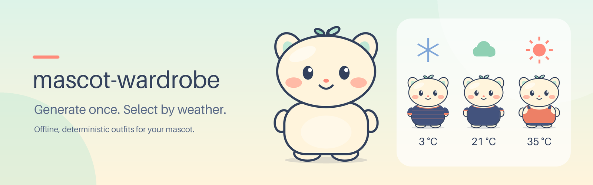
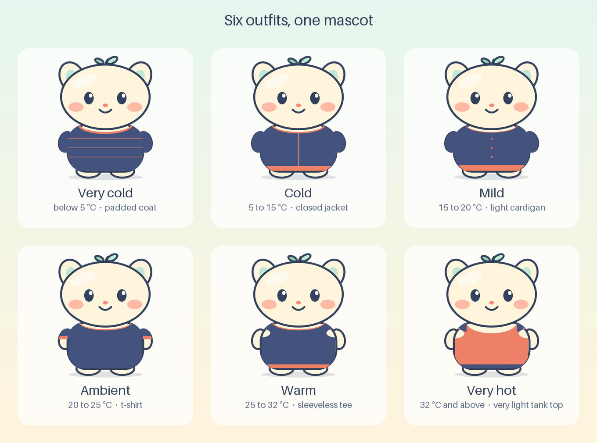

# mascot-wardrobe



Give it a PNG of your own mascot and it dresses the mascot for six temperature bands. The six
outfits are generated **once** with local Pillow overlays. After that, picking the right outfit
for a temperature is a lookup in a manifest: no image work, no network, no model.

## Why generate once, select often

- Generation is the only step that touches pixels. It is local, deterministic and idempotent.
- Selection reads the manifest and returns the path of an outfit that already exists, so it is
  instant, repeatable and safe to run from a scheduler every few hours.
- There is no AI or LLM dependency and no recurring inference cost. The same input always gives
  the same output hashes when run with the same Pillow and libjpeg toolchain; a different Pillow
  wheel can encode pixels or JPEG bytes differently.



The image above is `assets/contact-sheet.png`: six outfits made by the real pipeline from the
bundled example mascot with the BR preset. Both images and the mascot itself are original
artwork, reproducible with `art/generate_art.py` (see `art/README.md`).

## Install

Requires Python 3.11 or newer. From a checkout of this repository, in a clean virtual
environment:

```sh
python -m venv .venv && . .venv/bin/activate && pip install .
mascot-wardrobe --help
```

For development use `pip install -e '.[dev]'`.

## Quickstart

Run these from the root of the repository checkout, where `examples/mascot.png` lives. Outputs
go to `./mascot-wardrobe-out/` by default (ignored by git). Replace the mascot path and the
body box with your own to use your own mascot.

```sh
# 1. Generate six outfits once (country is always explicit; no geolocation).
# The example mascot ships with its own explicit body box (arms to hem, below the head).
mascot-wardrobe generate --mascot examples/mascot.png --id sunny --country BR \
  --body-box 0.125 0.555 0.875 0.915 --style classic --palette auto

# 2. Select by temperature as often as you like (28 C is "warm" in the BR preset).
mascot-wardrobe select --manifest mascot-wardrobe-out/catalog/manifest.json \
  --country BR --temperature 28

# 3. Export the selection to a channel folder; a Fahrenheit input works too.
mascot-wardrobe demo --manifest mascot-wardrobe-out/catalog/manifest.json \
  --country BR --temperature 77 --unit F --channel telegram
```

`demo` performs the export twice and shows `"action": "exported"` followed by
`"action": "unchanged"` with `"remote_sync": false`: the second run does not rewrite anything.
Files are copied to `mascot-wardrobe-out/exports/<channel>/<slug>/`.

Use `--body-box X1 Y1 X2 Y2` (normalized, default `0.22 0.60 0.78 0.88`) to tell the compositor
where your mascot's body is: the templates are fitted to the silhouette measured inside that box
(neckline, shoulders, sleeves, hem); there is no face or limb detection. `--style` (`classic` or
`streetwear`) and `--palette` (one to six `#RRGGBB` colours, or `auto`) are asked on a terminal and
required otherwise (exit 2, nothing written), so scripts pass them explicitly. `auto` is
deterministic and local; no reference images are sent or fetched. See
[docs/wardrobe.md](docs/wardrobe.md).

## Identity-locked closet

`mascot-wardrobe closet` keeps one mascot as an immutable, hash-pinned source and an explicit
binary edit mask, lets you add, edit and remove clothing items, save and switch named wardrobes,
and builds a catalog sheet from the saved item files. Pixels outside the mask are verified
byte-identical to the source, and a changed mascot, mask or item is detected. A closet made by an
older release is upgraded with `closet migrate [--dry-run]` (backup, atomic). See
[docs/closet.md](docs/closet.md).

```bash
mascot-wardrobe closet init --mascot mascot.png --mask mask.png
mascot-wardrobe closet add coat --template very_cold --style classic --palette "#2878b5" "#e8b84b"
mascot-wardrobe closet save winter --items coat
mascot-wardrobe closet use winter && mascot-wardrobe closet catalog
```

## Publishing a profile photo (opt-in)

`mascot-wardrobe publish` selects one outfit and delivers the same square JPEG to the channels
you configure, and prints the matching atlas path for the Hermes pet. It is a **dry-run by
default**; nothing changes until you add `--apply` and a configured channel.

```sh
mascot-wardrobe publish --manifest mascot-wardrobe-out/catalog/manifest.json --country BR \
  --temperature 22 --whatsapp-catalog-dir /path/to/bridge/approved-photos \
  --whatsapp-bridge-url http://127.0.0.1:3000 --whatsapp-bridge-header "Name: value" \
  --telegram --telegram-expected-bot-id 123456789          # dry-run
```

Supported scope only: WhatsApp through the local Hermes/Baileys bridge (run it on the Hermes
host; loopback only) and the Telegram **bot itself** (not a personal account). The Telegram
token comes from the `MASCOT_WARDROBE_TELEGRAM_BOT_TOKEN` environment variable; Telegram results
are acknowledged but unverified. It needs no LLM or image API. See [docs/channels.md](docs/channels.md)
the uninstalled [scheduler examples](docs/scheduler.md) and the
[installation and integration guide](docs/integration.md), which also states that a separately
installed Hermes weather scheduler is not wired to this project.

## Offline deterministic demo

Everything above is offline. `scripts/e2e-smoke.sh` runs the whole flow against a freshly built
wheel in a throwaway virtual environment: it generates twice and compares hashes and mtimes,
selects one outfit per category plus a Fahrenheit input, and runs `demo` twice to prove the
second run is `unchanged`. It never passes `--live-weather`. It uses `$PYTHON`, else
`.venv/bin/python`, else `python3`, and that interpreter needs the build module
(`pip install build`); the outputs go to a fresh run directory and nothing existing is deleted.

## Live weather (optional)

Weather is opt-in and never guessed. You pass explicit coordinates; the tool never geolocates:

```sh
mascot-wardrobe select --manifest mascot-wardrobe-out/catalog/manifest.json \
  --country BR --live-weather --latitude -23.55 --longitude -46.63
```

It calls the public Open-Meteo forecast API for the current temperature in Celsius. If the
service fails, times out, answers with bad data or the reading is older than 3 hours or more
than 15 minutes in the future, the command exits with status 2 and an `error:` line. It never
substitutes an invented temperature. Details are in [docs/configuration.md](docs/configuration.md).
The automated tests use a fake transport; a live call is an optional manual smoke check.

## Country presets and configuration

BR, GB, US and JP presets define five strictly increasing Celsius boundaries (six categories).
A boundary value belongs to the upper category. The presets are adjustable product defaults,
not universal truth, and you can supply your own profiles file. All boundary tables (Celsius and
Fahrenheit) and the profile schema are in [docs/configuration.md](docs/configuration.md).

## Documentation

- [Installation and integration guide](docs/integration.md)
- [Architecture](docs/architecture.md) and the [ADRs](docs/adr/)
- [Configuration, weather and time semantics](docs/configuration.md)
- [Wardrobe compositor and atlas layout](docs/wardrobe.md)
- [Identity-locked closet, wardrobes and catalog](docs/closet.md)
- [Channels (sandbox exports and opt-in live adapters)](docs/channels.md)
- [Scheduler examples (not installed)](docs/scheduler.md)
- [Traceability](docs/traceability.md) and [verification](docs/verification.md)

## Limitations

- No semantic understanding: the compositor is geometric. It does not detect faces or limbs
  and it does not draw realistic clothing.
- Overlays are geometric shapes fitted to the silhouette inside the body box you provide. A wrong
  box gives a wrong result.
- Opaque PNGs: existing transparency is preserved, but an opaque background is not removed. A body
  box that is fully opaque fails with a clear `FitError` (exit 2) unless a closet edit mask is
  used; use a transparent PNG or the closet.
- Country presets are product defaults, not meteorological or health standards, and one country
  can have many climates.
- Sandbox channels are export-only: a file and loopback test fixture, not a real account.
  Real profile changes happen only through `publish --apply`, limited to the Hermes WhatsApp
  bridge and a Telegram bot; Telegram is never verified, only acknowledged.
- Atlas animation is a geometric translation of the portrait, not an articulated animation.

## Security

- Sandbox use needs no credentials. `publish --apply` with Telegram reads a bot token from the
  environment only and never stores or prints it. There are no runtime model calls.
- Output paths reject `..` and symbolic links; file names and slugs are validated and input
  PNG size is bounded.
- The optional HTTP sandbox bridge binds to loopback only and is a local contract test.
- The only external request by default is the opt-in `--live-weather` call to Open-Meteo.
  Separately, the sandbox bridge and its client talk over loopback HTTP on your own machine.
  `publish --apply` additionally talks to your loopback Hermes bridge and, if enabled, to
  `api.telegram.org`.
- Nothing is installed as a service; scheduler files are `.example` templates only.

See [SECURITY.md](SECURITY.md) for reporting and scope, and [CONTRIBUTING.md](CONTRIBUTING.md)
to help out.

## License

MIT, for the code and the bundled artwork. See [LICENSE](LICENSE).
